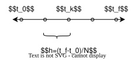
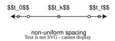

# Trajectory optimizer

## Optimal control problem

The solver attemps to solve the following type of optimal control problem. Point to point trajectories which are optimal and within the constraints are computed.

$$J(x,u)=\int_{t_0}^{t_f}L(x,u)\mathrm{d}t$$ $$x(t_0)=x_0,~x(t_f)=x_f$$ $$\dot{x}=f(x,u)$$ $$x_l\leq  x \leq x_u$$ $$u_l\leq  x \leq u_u$$

where, 
$t_0,t_f,L(x,u) \in \mathbb{R}$
$ x,x_0,xf,x_{l},x_{u}, f \in \mathbb{R}^{N_x}$
$u,u_{l},u_{u} \in \mathbb{R}^{N_u}   $

## Numerical solution

 It is not possible to derive an analytical solution in every case of an optimal control problem. Numerical methods are widely used to solve them. The solver uses direct methods where the continuos time optimal control problem is discretized and then optimized. This will be referred to as transcription of the optimal control problem.

The following discretization schemes are supported by the solver.

### Time

The time interval $t \in [t_0,t_f]$, is divided into $N$ intervals such that
$t_k=[t_0+(k-1)(t_f-t_0)/N]$. On this grid, the numerical differentiation and integration is performed.

#### Pseudospectral collocation

An exception is the pseudospectral collocation method where a non-uniform grid clustered at the end points is used. It allows Runge phenemenon to be avoided for global polynomials of higher degree.

Let $\tau_k$ is the kth LGL collocation point and they are mapped to the physical time  domain as $t=\frac{(t_f-t_0)}{2}\tau+\frac{(t_f+t_0)}{2}$.

### Numerical integration

#### Riemann sum

The integrand $L$ is approximated as a piecewise-constant function over each interval. The area is computed in each interval by finding the area of the rectangle. On the kth interval, $L_k$ or $L_{k+1}$ may be used to compute the area. The area is summed over all the intervals to compute the integral.

$$\int_{t_0}^{t_f}L(x,u)\mathrm{d}t \approx \sum_{k=1}^{N+1} L(x_k,u_k)h$$

#### Trapezoidal

The integrand is assumed to be a piecewise-linear function. Over each interval, the area of the trapezoid is computed and summed over to compute the integral. Compared to the Riemann sum, it required an additional function evaluation and more expensive.

$$\int_{t_0}^{t_f}L(x,u)\mathrm{d}t \approx \sum_{k=1}^{N+1} \frac{1}{2}h(L(x_k,u_k)+L(x_{k+1},u_{k+1}))$$

#### LGL quadrature

Over the non-uniform grid, a global polynomial approximation is used for the integrand. From LGL theory, integrating the polynomial simplifies to the following quadrature rule where weighted sum of the integrand at the collocation points is computed.

$$\int_{t_0}^{t_f}L(x,u)\mathrm{d}t \approx \sum_{k=1}^{N+1} w_kL(x_k,u_k)$$

### Differentiation

#### Euler forward

$$x_{k+1}-x_k=f(x_k,u_k)=f_k$$

#### Euler backward

$$x_{k+1}-x_k=f(x_{k+1},u_{k+1})=f_{k+1}$$

#### Heun's method

$$x_{k+1}-x_k=\frac{1}{2}(f(x_{k},u_{k})+f(x_{k+1},u_{k+1}))=\frac{1}{2}(f_k+f_{k+1})$$

#### Runge Kutta 45

$$
\begin{aligned}
  k_1&=f(x_k,u_k)  \\
  k_2&=f(x_k+\frac{1}{2}hk_1,u_k)\\
  k_3&=f(x_k+\frac{1}{2}hk_2,u_k)\\
  k_4&=f(x_k+k_3h,u_k)\\
  x_{k+1}-x_k&=\frac{1}{6}h(k_1+2k_2+2k_3+k_4)
\end{aligned}
$$

#### Trapezoidal collocation

$$x_{k+1}-x_k=\frac{1}{2}(f(x_k,u_k)+f(x_{k+1},u_{k+1}))=\frac{1}{2}h(f_k+f_{k+1})$$

#### Hermite simpson collocation

$$
\begin{aligned}
x_c&=\frac{1}{2}(x_k+x_{k+1})+\frac{1}{8}h(f(x_k,u_k)-f(x_{k+1},u_{k+1}))\\
u_c&=\frac{1}{2}(u_k+u_{k+1})\\
x_{k+1}-x_k&=\frac{1}{6}h(f(x_k,u_k)+4f(x_c,u_c)+f(x_{k+1},u_{k+1}))
\end{aligned}
$$

#### LGL pseudospectral collocation

$$\sum_{i=1}^{N+1}D_{k,i}x_i=f(x_k,u_k)$$

## NLP solver

### IPOPT

A off-the-shelf solver using interior point method for NLP.
 
### Custom solvers

Generate optimization object for the given OCP which can be interface with any NLP solver.

Object should include

1. Objective function
2. Inequality and equality constraints
3. gradient, Jacobian and Hessian
4. To make tailored solver for the NLP

### Scipy solvers

Yet to be explored

## Derivatives

### Automatic differentiation

Derivatives are computed by differenting machine code and they are accurate as hand written derivatives. The functions must be differentiable and software availability promotes its usage.

### Finite difference

Based on Taylor series approximation, where 1st order terms are only considered. Most commonly used method to compute derivatives and works on black box model. They are limited due to approximation and numerical errors.

## Sparsity

Depends on

1. Decision vector order
    1. State, control pairs
    2. State and control
2. Discretization method

## Guess generation

The optimal solution is only as good as the initial guess as the NLP from transcription is usuallly non-convex, which implies mutiple local minimum are possible.
A good guess to solver must satisfy,

1. respect the inequalities
2. respect the dynamics

A feasible guess can lead to higher success rates while the solver iterates.

## Error
Discretization error needs to be computed

## Grid convergence

Finer discretization leads to smaller numerical errors from the transcription process. By increasing the number of intervals a good solution can be computed.

## Plotter

The solution obtained from the NLP solver is interpolated and plotted.

## Analytical comparison

If analytical solution is available, it must be compared.

##  Solution and plots to be saved