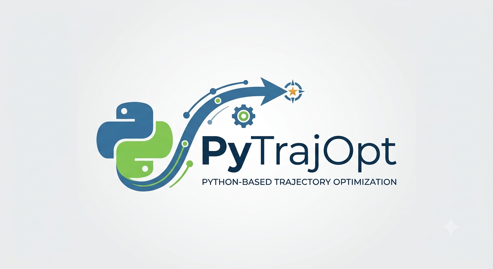

  

## PyTrajOpt

**PyTrajOpt** (Python-based Trajectory Optimization) is a modern Python framework for solving complex optimal control problems (OCPs). Powered by CasADi for high-performance symbolic differentiation and Pydantic for strict runtime configuration validation, PyTrajOpt supports both single-phase and multiphase formulations via multiple shooting and direct collocation. It goes a step further by estimating state costates and performing rigorous feasibility checks to ensure the reliability of your generated solutions.

## Documentation

For more details about problems supported, installation, examples and api references refer to the docs.

## References

1. [ally_chen.py](ally_chen.py) — hen, Weifeng, and Lorenz T. Biegler. “Nested Direct Transcription Optimization for Singular Optimal Control Problems.” AIChE Journal, vol. 62, no. 10, Oct. 2016, pp. 3611–27. DOI.org (Crossref), https://doi.org/10.1002/aic.15272.
2. [brachistochrone.py](brachistochrone.py) — Ross, I. M., et al. “Scaling and Balancing for High-Performance Computation of Optimal Controls.” Journal of Guidance, Control, and Dynamics, vol. 41, no. 10, Oct. 2018, pp. 2086–97. DOI.org (Crossref), https://doi.org/10.2514/1.G003382.
3. [cart_costate.py](cart_costate.py) — Conway, B. A., and K. M. Larson. “Collocation Versus Differential Inclusion in Direct Optimization.” Journal of Guidance, Control, and Dynamics, vol. 21, no. 5, Sept. 1998, pp. 780–85. DOI.org (Crossref), https://doi.org/10.2514/2.4306.
4. [container_crane.py](container_crane.py) — https://archiv.ub.uni-heidelberg.de/volltextserver/24212/1/Dissertation_Bergner17.pdf
5. [free_flying_robot.py](free_flying_robot.py) — Betts, John T. Practical Methods for Optimal Control and Estimation Using Nonlinear Programming. Second, Society for Industrial and Applied Mathematics, 2010. DOI.org (Crossref), https://doi.org/10.1137/1.9780898718577.
6. [hypersensitive.py](hypersensitive.py) — Betts, John T. Practical Methods for Optimal Control and Estimation Using Nonlinear Programming. Second, Society for Industrial and Applied Mathematics, 2010. DOI.org (Crossref), https://doi.org/10.1137/1.9780898718577.
7. [lee_ramirez_reactor.py](lee_ramirez_reactor.py) — hen, Weifeng, and Lorenz T. Biegler. “Nested Direct Transcription Optimization for Singular Optimal Control Problems.” AIChE Journal, vol. 62, no. 10, Oct. 2016, pp. 3611–27. DOI.org (Crossref), https://doi.org/10.1002/aic.15272.
8. [low_thrust.py](low_thrust.py) — Ross, I. Michael, et al. “Low-Thrust, High-Accuracy Trajectory Optimization.” Journal of Guidance, Control, and Dynamics, vol. 30, no. 4, July 2007, pp. 921–33. DOI.org (Crossref), https://doi.org/10.2514/1.23181.
9. [moon_lander_time_dilation.py](moon_lander_time_dilation.py) — Meditch, J.. (1964). On the problem of optimal thrust programming for a lunar soft landing. IEEE Transactions on Automatic Control, 9(4), 477–484. doi:10.1109/tac.1964.1105758 https://gpops2.com/examples/moonlander.html
10. [rocket.py](rocket.py) — https://web.casadi.org/blog/nlp-scaling/
11. [rocket_multiphase.py](rocket_multiphase.py) — Ross, I. Michael, and Fariba Fahroo. Pseudospectral Knotting Methods for Solving Nonsmooth Optimal Control Problems. Journal of Guidance, Control, and Dynamics, vol. 27, no. 3, May 2004, pp. 397–405. DOI.org (Crossref), https://doi.org/10.2514/1.3426.
12. [shuttle_cross_range.py](shuttle_cross_range.py) — Betts, John T. Practical Methods for Optimal Control and Estimation Using Nonlinear Programming. Second, Society for Industrial and Applied Mathematics, 2010. DOI.org (Crossref), https://doi.org/10.1137/1.9780898718577.