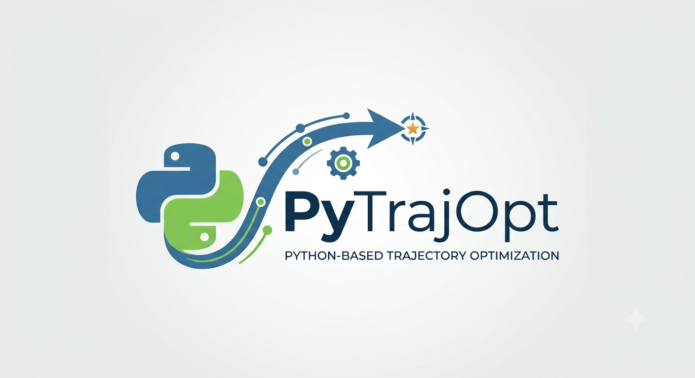

  

Pytrajopt is an open-source Python library for 
nonlinear trajectory optimization, built on transcription 
using direct multiple shooting and collocation, with Pydantic
validation to model the optimal control problem and a CasADi
backend to formulate and solve the nonlinear program.